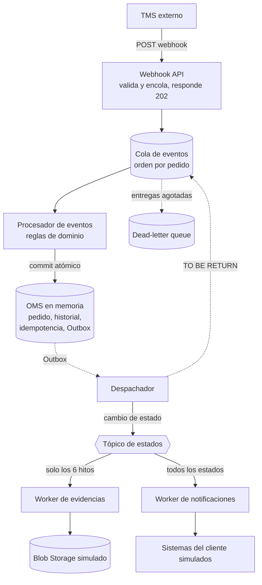

# Integración TMS → OMS

Integración entre un **TMS externo** (Beetrack) y el **OMS interno** de una empresa de logística. Recibe eventos de seguimiento por webhook, actualiza el estado de los pedidos, descarga y guarda las evidencias, y notifica a cada cliente con su propia estructura.

Proyecto en **.NET 10 (C#)**. Todas las dependencias externas (cola, tópico, base de datos, almacenamiento, sistemas de los clientes) están **simuladas en memoria**, por lo que se ejecuta sin conectarse a ningún servicio.

## Qué hace

| Requisito | Dónde se resuelve |
|---|---|
| Recibir y validar eventos del TMS | `Webhook` (`POST /webhooks/tms`) y `TmsEventTranslator` |
| Actualizar el estado sin tocar pedidos en estado final | `Order.Apply` (dominio) |
| Contador de visitas (+1 en DELIVERED y NOT DELIVERED) | `Order.Apply` |
| Auto-emitir TO BE RETURN al llegar a 3 visitas | `Order.Apply` + Outbox |
| Historial de eventos | `HistoryEntry`, guardado en cada commit |
| Evidencias solo en seis hitos | Filtro de la suscripción + `EvidenceHandler` |
| Notificación con estructura propia por cliente | `NotificationHandler` + adaptadores |
| Reintentos y consistencia sin pérdida de datos | Reintentos por capas, DLQ, idempotencia y Outbox |

## Arquitectura



Cada suscripción del tópico es una cola independiente, con su propio bloqueo, reintentos y dead-letter queue.

### Flujo de un evento

1. El TMS envía el evento. El webhook valida la API key, la estructura y los valores, lo encola y responde **202**.
2. El **procesador** toma el mensaje, descarta duplicados, aplica las reglas del dominio y guarda en **una sola operación atómica**: estado, historial, marca de idempotencia y los mensajes pendientes de publicar (Outbox).
3. El **despachador de Outbox** publica el cambio de estado en el tópico y, si corresponde, reinyecta el evento TO BE RETURN en la cola.
4. El **worker de evidencias** (solo en los seis hitos) descarga los archivos y los guarda.
5. El **worker de notificaciones** traduce el mensaje a la estructura del cliente y lo envía, protegido por un circuit breaker por cliente.

## Cómo ejecutarlo

Requisitos: **SDK de .NET 10**.

```bash
dotnet build
dotnet test
dotnet run --project Integracion.TmsOms.Api
```

La consola muestra el puerto (`Now listening on: http://localhost:XXXX`); depende de `Integracion.TmsOms.Api/Properties/launchSettings.json`. Todos los datos viven en memoria: **reiniciar la API restaura los datos de ejemplo**.

### Probarlo

El archivo `Integracion.TmsOms.Api/requests.http` contiene todos los escenarios listos para enviar. Funciona en Visual Studio (enlace **Send request**) y en VS Code con la extensión REST Client. Antes de usarlo, ajusta `@host` al puerto de la consola.

**Datos de ejemplo** que el OMS conoce al arrancar:

| Pedido | Cliente | Formato de notificación |
|---|---|---|
| `2500000006-01` | `01021755` | estándar (`standard-v1`) |
| `2500000007-01` | `01021755` | estándar (`standard-v1`) |
| `2500000008-01` | `02034411` | antiguo (`legacy-v1`), solo algunos estados |

El webhook exige el encabezado `X-Api-Key`. En desarrollo vale `dev-secret-key` (`Tms:ApiKey` en `appsettings.json`).

## Estructura de la solución

```
Integracion.TmsOms.sln
├── Integracion.TmsOms.Domain          Reglas de negocio puras, sin dependencias
├── Integracion.TmsOms.Application     Casos de uso e interfaces (puertos)
├── Integracion.TmsOms.Infrastructure  Implementaciones en memoria (adaptadores)
├── Integracion.TmsOms.Api             Webhook, workers en segundo plano y diagnóstico
└── Integracion.TmsOms.Tests           Pruebas (xUnit)
```

Las dependencias apuntan hacia adentro: `Api → Infrastructure → Application → Domain`. La lógica no conoce ninguna tecnología concreta; solo conoce interfaces. Sustituir una simulación por un servicio real no toca la lógica de negocio.

Los workers corren como servicios en segundo plano **dentro del proceso de la API**. Es una decisión consciente para que un solo `dotnet run` lo levante todo; cada worker es una clase independiente que solo depende de interfaces, así que separarlos en procesos distintos sería un cambio de despliegue, no de código.

## Qué se simula y qué es real

La simulación reproduce el **comportamiento** del servicio real, no solo su forma.

| Componente | Simulación | Servicio real equivalente |
|---|---|---|
| Cola de eventos | `InMemoryMessageQueue`: bloqueo, reentrega, contador de entregas, DLQ y orden por pedido | Azure Service Bus (cola con sesiones por pedido) |
| Tópico de estados | `InMemoryTopic`: copia por suscripción, filtros y DLQ propia | Service Bus (tópico con suscripciones y filtros) |
| OMS | `InMemoryOmsStore`: copias, versión, commit atómico | Base de datos relacional con transacciones |
| Outbox | Dentro del mismo almacén | Tabla en la misma transacción más un despachador |
| Idempotencia | Claves procesadas por consumidor | Tabla con clave única |
| Descarga de evidencias | `SimulatedEvidenceDownloader` | `HttpClient` hacia el TMS |
| Almacenamiento | `InMemoryEvidenceStorage` | Azure Blob Storage (contenedor privado) |
| Sistemas de clientes | `InMemoryClientEndpoint` | Llamadas HTTP a cada cliente |

**Se implementa de verdad** (es lo que se evalúa): las reglas de dominio, la validación y traducción del webhook, la idempotencia, los reintentos por capas, el paso a DLQ, el Outbox, el fan-out con filtros, los adaptadores por cliente y el circuit breaker.

## API

### Webhook

| Método | Ruta | Respuestas |
|---|---|---|
| `POST` | `/webhooks/tms` | `202` aceptado, `400` payload inválido (devuelve todos los errores), `401` sin API key o incorrecta |

Acepta el encabezado opcional `X-Correlation-Id`; si no llega, se genera uno.

### Diagnóstico

Como todo está en memoria, no hay una base de datos que abrir. Estos endpoints muestran el estado interno:

| Método | Ruta | Qué muestra |
|---|---|---|
| `GET` | `/diagnostics/orders/{pedido}` | Estado, visitas, versión e historial completo |
| `GET` | `/diagnostics/orders/{pedido}/evidences` | Evidencias guardadas y su ruta |
| `GET` | `/diagnostics/clients/{cliente}/notifications` | Lo que recibió el sistema del cliente |
| `GET` | `/diagnostics/queue` | Cola, Outbox y suscripciones del tópico |
| `GET` | `/diagnostics/circuits` | Estado del circuit breaker por cliente |
| `GET` | `/diagnostics/dead-letters` | DLQ de la cola principal |
| `POST` | `/diagnostics/dead-letters/{id}/reprocess` | Devuelve el mensaje a la cola |
| `GET` | `/diagnostics/subscriptions/{evidences\|notifications}/dead-letters` | DLQ de cada suscripción |
| `POST` | `/diagnostics/subscriptions/{nombre}/dead-letters/{id}/reprocess` | Reprocesa un mensaje de esa DLQ |
| `POST` | `/diagnostics/clients/{cliente}/simulation` | Cambia en caliente cómo responde un cliente simulado |

Cuerpo de `simulation`: `{ "failFirstAttempts": 2, "rejectAlways": false }`.

## Escenarios de demostración

Todos están en `requests.http`. **Cada evento necesita una `eventDate` distinta**: repetir la misma fecha se trata como duplicado, que es justamente el comportamiento que se quiere mostrar.

| Escenario | Qué hacer | Resultado esperado |
|---|---|---|
| Entrega exitosa | Enviar un `DELIVERED` al pedido 06 | El pedido queda `Delivered` con 1 visita, 2 evidencias guardadas y 1 notificación al cliente |
| Evento duplicado | Enviar la misma petición dos veces | Ambas responden 202, pero el contador no se incrementa |
| Pedido en estado final | Tras el `DELIVERED`, enviar otro evento al mismo pedido | El pedido no cambia; el historial lo registra como `IgnoredFinalState` |
| Tres visitas fallidas | Enviar 3 `NOT DELIVERED` al pedido 07 con fechas distintas | El pedido pasa a `ToBeReturn` con 3 visitas y 4 entradas de historial |
| Evidencias solo en hitos | Enviar un `STARTED` | Llega la notificación, pero no se guardan evidencias |
| Estructura por cliente | Comparar las notificaciones de `01021755` y `02034411` | Claves en inglés y fecha ISO frente a claves en español y `dd/MM/yyyy` |
| Seguridad y validación | Enviar sin API key, y con valores inválidos | `401`, y `400` con todos los errores a la vez |
| Pedido inexistente | Enviar un evento de `NO-EXISTE` | 5 entregas fallidas y paso a la DLQ de la cola principal |
| Evidencia temporal | Un archivo llamado `...FAIL-TRANSIENT-4.jpg` | Reintentos, el mensaje vuelve a la cola y la segunda entrega lo guarda |
| Evidencia inexistente | Un archivo llamado `FAIL-PERMANENT.jpg` | Directo a la DLQ de evidencias, sin reintentos; las demás evidencias sí se guardan |
| Cliente caído | Configurar al cliente `02034411` para fallar y enviar un evento de su pedido | El circuito se abre y el mensaje se pospone; al recuperarse el cliente, se entrega |
| Cliente que rechaza | Configurar `01021755` con `rejectAlways` | DLQ de notificaciones, sin abrir el circuito; tras corregir, se reprocesa |

## Decisiones de diseño

- **Aceptar rápido, procesar después.** El webhook solo valida y encola. Así el TMS no espera al OMS, y una caída del OMS no hace perder eventos.
- **Commit atómico y Outbox.** Estado, historial, idempotencia y mensajes a publicar se guardan juntos. Nunca queda un pedido cambiado sin que nadie se entere.
- **Idempotencia en cada consumidor.** El procesador usa una clave del evento (pedido, estado, subestado y fecha, porque la trama no trae un identificador). Evidencias guarda por ruta de archivo. Notificaciones marca lo enviado y manda un `notificationId` único para que el cliente descarte duplicados.
- **Reintentos por capas.** Reintento inmediato con espera creciente, reentrega de la cola y, al agotarse, dead-letter queue. Los fallos permanentes van directo a la DLQ sin reintentos.
- **Posposición sin penalizar.** Con el circuito abierto, el mensaje espera sin consumir entregas, para que un cliente caído no mande sus avisos a la DLQ.
- **Orden por pedido.** La cola no entrega un mensaje mientras haya otro anterior del mismo pedido en proceso. Además, el pedido lleva un número de versión (control de concurrencia optimista).
- **Dominio puro.** `Order.Apply` recibe un evento y devuelve un resultado, sin tocar colas ni reloj. Las reglas se prueban sin infraestructura.
- **Capa anticorrupción.** `TmsEventTranslator` traduce la trama del TMS al modelo interno, así un cambio del proveedor queda contenido en un solo punto.
- **Un adaptador por cliente.** Agregar un cliente es agregar un adaptador y su configuración, sin tocar el worker.
- **Circuit breaker por cliente.** Un cliente caído no retrasa a los demás. Solo cuentan los fallos temporales: un rechazo permanente indica que el cliente responde, no que esté caído.

## Supuestos

El enunciado deja puntos abiertos. Estas son las interpretaciones adoptadas:

| Punto abierto | Supuesto |
|---|---|
| Significado de "push" | Webhook de salida hacia el sistema del cliente |
| TO BE RETURN con tercera visita `DELIVERED` | El pedido queda cerrado y no se pide devolución. La auto-emisión aplica tras un `NOT DELIVERED` |
| Evento sobre un pedido en estado final | Se registra en el historial como ignorado, sin modificar estado ni contador |
| Zona horaria de `eventDate` | Hora de Perú (UTC-5), configurable en `Tms:SourceUtcOffsetHours` |
| Autenticación del webhook | API key en el encabezado `X-Api-Key` |
| URLs de evidencias | No se validan: la trama de ejemplo trae `htps://`, y la descarga está simulada |

## Configuración (`appsettings.json`)

| Sección | Claves | Por defecto |
|---|---|---|
| `Tms` | `ApiKey`, `SourceUtcOffsetHours` | `dev-secret-key`, `-5` |
| `Queue` | `MaxDeliveryCount`, `LockDurationSeconds`, `RedeliveryDelayMilliseconds` | `5`, `30`, `500` |
| `Retry` | `MaxAttempts`, `InitialDelayMilliseconds` | `3`, `200` |
| `Workers` | `PollIntervalMilliseconds` | `100` |
| `Evidence` | `MaxSizeBytes`, `AllowedExtensions` | 5 MB; `.jpg`, `.jpeg`, `.png`, `.pdf` |
| `CircuitBreaker` | `FailureThreshold`, `OpenDurationSeconds` | `3`, `10` |
| `Clients` | Por código de cliente: `Format`, `Destination`, `NotifyStatuses` | Dos clientes de ejemplo |

Los tiempos de espera son cortos a propósito, para que las demostraciones tarden segundos.

## Pruebas

`dotnet test` ejecuta **111 pruebas**:

- **Unitarias (99):** reglas de dominio (estado final, contador, auto-emisión, claves de idempotencia), política de reintentos, circuit breaker, cola, tópico y dead-letter queue (bloqueo, reentrega, posposición, orden por clave, reproceso), traducción del webhook, procesador de eventos (duplicados, concurrencia, atomicidad), evidencias y notificaciones.
- **De integración (12):** levantan la API real en memoria con `WebApplicationFactory` y envían peticiones HTTP al webhook con los workers corriendo. Cubren autenticación y validación, el flujo completo, duplicados, estado final, las tres visitas fallidas, la dead-letter queue con su reproceso, el reintento de evidencias, el rechazo permanente de un cliente y la apertura y recuperación del circuit breaker.

Las pruebas de integración usan esperas cortas configuradas solo para ellas, y una API independiente por prueba. Para ejecutarlas por separado:

    dotnet test --filter "FullyQualifiedName~WebhookIntegrationTests"

## Limitaciones y paso a producción

- **Todo es volátil.** Reiniciar la API borra pedidos, historial, colas y evidencias.
- **El Outbox no es durable.** En producción debe vivir en la misma base de datos y transacción que el estado.
- **Un cliente caído de forma indefinida mantiene sus mensajes esperando.** En producción se resolvería con un tiempo de vida del mensaje que lo envíe a la DLQ al caducar.
- **Reprocesar desde la DLQ coloca el mensaje al final de la cola.** Si llegaron eventos posteriores del mismo pedido, el orden puede alterarse; la regla de estado final protege lo más delicado.
- **La API key está en `appsettings.json`.** En producción iría en un almacén de secretos.
- **Un solo proceso.** El diseño permite separar los workers sin cambiar su código.
- **Reintentos propios.** Se implementaron sin dependencias externas; en producción la librería habitual en .NET es Polly.